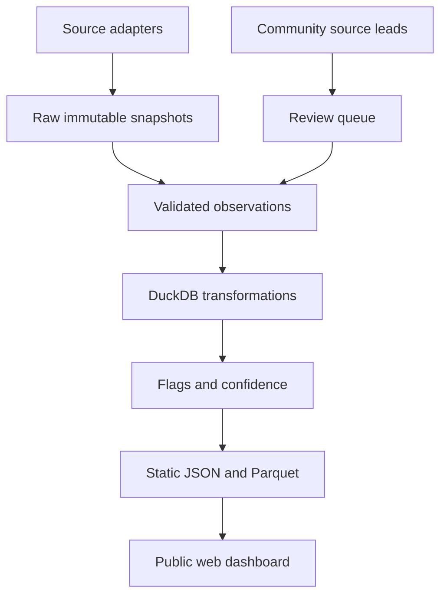

# Open Compute Markets Observatory

## Research map and build plan for a public, contributor-owned dashboard

**Research date:** 25 August 2026  
**Purpose:** turn the AI-compute supply chain described in the Dwarkesh Patel–Dylan Patel podcast into a public, open-source set of prices, quantities, financing conditions, and explicitly documented data gaps.  
**Audience:** curious readers, researchers, journalists, investors, policymakers, and contributors.  
**Important:** this is a research product, not investment advice. A public webpage is not automatically a redistributable dataset; every adapter must respect the source's license and terms.

---

## 1. The product in one sentence

Build a public website that answers:

> Where is AI infrastructure becoming scarcer, cheaper, more leveraged, or harder to build—and what evidence supports that conclusion?

The dashboard should never pretend that every bottleneck has a quoted market. It should keep four kinds of evidence visually separate:

1. **Market prices:** an actual traded or posted price, such as SOFR, copper, a public cloud GPU rate, or a power-market locational marginal price.
2. **Operating quantities:** revenue, imports, construction spending, generation queues, or CapEx. These are not prices, but they help explain price pressure.
3. **Proxies:** a related public measure used because the desired market is private. A data-center REIT share price is a proxy for investor expectations, not the price of powered land.
4. **Unobserved markets:** negotiated prices such as HBM contracts, advanced-packaging slots, private power-purchase agreements, project-loan spreads, and powered-land transactions. These should appear as data gaps, not disappear.

### Working name

**Open Compute Markets Observatory (OCMO)**. Use a neutral research identity. Avoid names that sound like a trading service or imply affiliation with the podcast.

---

## 2. Availability labels

Every series, chart, and contribution must display one of these labels.

| Tag | Meaning | May the project ingest it? |
|---|---|---|
| `OPEN_API` | Public machine-readable API with a reuse path | Yes, subject to attribution and rate limits |
| `OPEN_DOWNLOAD` | Public CSV/XLSX/JSON or bulk file | Yes, if the license permits it |
| `PUBLIC_MANUAL` | Public page, PDF, filing, docket, or press release; not a stable API | Store metadata and extracted facts only when reuse is permitted; otherwise link out |
| `DELAYED_LICENSED` | A public delayed quote or display whose redistribution rights are limited | Default to link-out or bring-your-own-key; do not mirror until approved |
| `PROXY` | A public series that imperfectly represents the desired market | Yes, with the proxy relationship stated beside the chart |
| `NOT_PUBLIC` | The real price or contract is private, bilateral, or behind a paywall | No invented estimate; show the gap and research leads |

There are two independent confidence fields:

- **Source confidence:** official filing/API, exchange, established industry estimate, journalism, or community report.
- **Concept fit:** direct price, close proxy, loose proxy, or contextual indicator.

A highly reliable source can still be a poor proxy. The dashboard must communicate both.

---

## 3. What to track

### 3.1 Compute rental and accelerator markets

| Signal | Why it matters | Availability and source | Cadence | Suggested flag |
|---|---|---|---|---|
| AWS accelerator instance list price by chip, region, and commitment | Posted retail price of renting compute | `OPEN_API` with credentials through the [AWS Price List API](https://docs.aws.amazon.com/aws-cost-management/latest/APIReference/API_pricing_PriceList.html) | Daily snapshot | Price change; SKU added/removed; region dispersion widens |
| Google Cloud accelerator SKU price | Same for Google; separates on-demand and commitment structures | `OPEN_API`, API key required, via the [Cloud Billing Catalog API](https://docs.cloud.google.com/billing/v1/how-tos/catalog-api) | Daily | Price/SKU/region change |
| Azure GPU VM retail and spot rate | Public retail and spot meter data | `OPEN_API`, unauthenticated, via the [Azure Retail Prices API](https://learn.microsoft.com/en-us/rest/api/cost-management/retail-prices/azure-retail-prices) | Daily | Price or availability-field change |
| GPU marketplace asking price | A more flexible, noisier estimate of marginal rental supply | `OPEN_API`/account-token candidate via [Vast.ai pricing and API documentation](https://docs.vast.ai/guides/instances/pricing); confirm display rights before enabling | Hourly or daily | Median 7-day price moves >15%; offer count drops >30% |
| Posted prices from specialist GPU clouds | Tracks Lambda, CoreWeave, Crusoe, RunPod and similar providers | `PUBLIC_MANUAL`; vendor pricing pages change and product definitions differ | Weekly | Manual verified change |
| Effective enterprise cloud discount | Large users often pay less than list price | `NOT_PUBLIC`; contracts, earnings calls, FinOps surveys, and procurement anecdotes | Event-driven | Data-gap update only |
| New accelerator selling price to hyperscalers | The economically relevant chip price is negotiated and bundled | `NOT_PUBLIC`; use company filings, distributor quotes, analyst channel checks | Quarterly/event | Data-gap update only |
| Used accelerator/server transaction price | Can reveal release of older fleets or shortages | `PROXY`; completed eBay listings, liquidators, server brokers, ServeTheHome classifieds; coverage and condition are inconsistent | Weekly manual | Price-volume dislocation |
| GPU availability or stock-out rate | Scarcity can show up in availability before list price | `PROXY`; cloud capacity errors, marketplace offer counts, community reports | Daily if terms permit | Available-region count falls materially |

**Normalization rule:** never compare “$/GPU-hour” without fields for accelerator model, GPU count, memory, interconnect, host CPU/RAM, region, commitment, tenancy, egress, and whether the instance is interruptible. Create derived estimates such as `$/HBM_GB_hour` only when the denominator is documented.

### 3.2 Silicon, memory, packaging, and semiconductor equipment

| Signal | Why it matters | Availability and source | Cadence | Suggested flag |
|---|---|---|---|---|
| DRAM and GDDR spot indications | Detects broad memory-cycle pressure; not an HBM price | `PUBLIC_MANUAL`/limited history on [TrendForce DRAM Price Trends](https://www.trendforce.com/price/dram/dram_spot). Link out unless its terms permit automated reuse | Daily | 20-day move >15%; spread between generations widens |
| HBM contract price by generation | Direct price of a central AI bottleneck | `NOT_PUBLIC`; TrendForce, TechInsights, Omdia, SemiAnalysis, memory-company calls, procurement sources | Quarterly/event | Research note only |
| HBM output, allocation, and lead time | Measures whether memory limits accelerator shipments | `NOT_PUBLIC`; triangulate producer guidance, suppliers, analyst estimates, and customer commentary | Quarterly/event | Estimate revisions or conflicting sources |
| Leading-edge wafer price by node/customer | Direct foundry input price | `NOT_PUBLIC`; foundry/customer contracts, analyst estimates, occasional journalism | Event | Research note only |
| Wafer starts, yield, and cycle time | Converts fab capacity into usable dies | `NOT_PUBLIC`; company commentary, supplier checks, technical press | Event | Research note only |
| Advanced-packaging price and available slots | CoWoS/other packaging can bind even when logic wafers exist | `NOT_PUBLIC`; TSMC/OSAT guidance plus TrendForce, TechInsights and SemiAnalysis estimates | Quarterly/event | Capacity-estimate revision; reported lead-time change |
| TSMC consolidated monthly revenue | High-frequency public indicator for the leading foundry, but not AI-only | `PROXY`, `PUBLIC_MANUAL`/scrapable only after terms review, from [TSMC monthly revenue](https://investor.tsmc.com/english/monthly-revenue/2026) | Monthly | YoY growth regime change; miss versus rolling trend |
| Public supplier revenue, inventory, CapEx, and guidance | Shows orders and investment across design, foundry, memory, tools, networking, and power | `OPEN_API` through [SEC EDGAR APIs](https://www.sec.gov/search-filings/edgar-application-programming-interfaces) for U.S. filers; foreign issuer IR pages as supplements | Filing/event | CapEx/revenue divergence; inventory days jump; guidance cut |
| U.S. semiconductor/electronics industrial production | Broad domestic output signal, not leading-edge global capacity | `PROXY`, `OPEN_API`; e.g. FRED series [IPB53122N](https://fred.stlouisfed.org/series/IPB53122N) or Federal Reserve G.17 | Monthly | 3-month annualized move outside historical band |
| Computer/electronics producer prices | Broad output-price pressure | `PROXY`, `OPEN_API`; BLS/FRED [PCU334334](https://fred.stlouisfed.org/series/PCU334334) | Monthly | 6-month change > historical 95th percentile |
| Semiconductor equipment billings | Tracks fab investment earlier than production | Headline releases are `PUBLIC_MANUAL`; detailed monthly/category data are `NOT_PUBLIC` subscriptions. See [SEMI Equipment Market Data](https://www.semi.org/en/products-services/market-data/emds) | Monthly/quarterly | Headline YoY reversal; gap remains explicit |
| Global semiconductor sales | Broad chip-cycle context, not AI-specific | SIA press-release headline is `PUBLIC_MANUAL`; detailed WSTS data are licensed. See [SIA market data](https://www.semiconductors.org/data-resources/market-data/) | Monthly | 3-month moving average acceleration |
| U.S. chip/equipment imports and exports | Physical trade proxy by HS code and country | `OPEN_API`, free account/key, via [USITC DataWeb](https://www.usitc.gov/applications/dataweb/api/dataweb_query_api.html); also [UN Comtrade API](https://uncomtrade.org/docs/un-comtrade-api/) | Monthly | Value/quantity divergence; country-share shift |
| Taiwan semiconductor and equipment exports | Closer to the production hub | `PUBLIC_MANUAL` downloads from [Taiwan Customs trade statistics](https://portal.sw.nat.gov.tw/APGA/GA30); terms limit unrestricted copying; UN Comtrade is a safer normalized fallback | Monthly | Export volume or destination mix shift |
| Silicon, gallium, germanium and other mineral supply | Context for upstream material concentration | `OPEN_DOWNLOAD`, annual, from [USGS Mineral Commodity Summaries](https://www.usgs.gov/centers/national-minerals-information-center/mineral-commodity-summaries) | Annual | Supply concentration or policy change |
| Specialty gas and chemical contract prices | Neon, helium, photoresist, and high-purity chemicals can bottleneck fabs | `NOT_PUBLIC`; gas-company calls, ICIS, Argus, S&P Global Commodity Insights, chemical distributors, trade press | Event | Research note only |

**Do not make this error:** DRAM spot is not HBM contract pricing; monthly TSMC revenue is not leading-edge wafer volume; a semiconductor ETF is not the price of a chip.

### 3.3 Data-center construction, land, buildings, and scarce equipment

| Signal | Why it matters | Availability and source | Cadence | Suggested flag |
|---|---|---|---|---|
| U.S. data-center construction spending | Direct spending on shells and fixed systems, excluding land and server racks | `OPEN_DOWNLOAD` in itemized Census construction-spending files. Census classifies data centers under office and explicitly excludes racks/servers; see [definitions](https://www.census.gov/construction/c30/definitions.html) and [downloads](https://www.census.gov/construction/c30/data/index.html) | Monthly | 3-month annualized growth >30%; large revision |
| Semiconductor-fab construction spending | Tracks domestic manufacturing buildout | `OPEN_DOWNLOAD`/`OPEN_API` at broader manufacturing categories via [Census Construction Spending](https://www.census.gov/construction/c30/c30index.html) | Monthly | Growth regime change |
| Data-center vacancy and asking rent by market | Direct measure of powered-shell scarcity | `NOT_PUBLIC` as a consistent series; periodic reports are `PUBLIC_MANUAL`: [CBRE Global Data Center Trends](https://www.cbre.com/insights/reports/data-center-trends-2026), [JLL North America Data Centers](https://www.jll.com/en-us/insights/market-dynamics/north-america-data-centers), plus Cushman & Wakefield/Newmark | Quarterly | Manual update; cite methodology and inventory boundary |
| Powered-land transaction price ($/acre and $/deliverable MW) | One of the most relevant but opaque asset prices | `NOT_PUBLIC` nationally. Build a community dataset from deeds, assessor/recorder records, tax documents, company releases, planning files, and credible reporting | Event | $/MW outlier; title/option transfer; power-date change |
| Raw industrial land transaction price | Separates ordinary land appreciation from the value of power rights | `PROXY`; county deeds/assessor GIS vary by jurisdiction; CoStar and MSCI Real Assets are paid national sources | Event/quarterly | Powered-land premium widens |
| Data-center site inventory and status | Locates capacity and construction pipeline | `PROXY`; community-verified records, [OpenStreetMap](https://www.openstreetmap.org/copyright/en) under ODbL, EPA/local permits. Commercial databases such as Baxtel and Data Center Map require license review | Weekly | Site status or MW estimate changes |
| Air permits and backup-generation capacity | Permits can reveal planned facilities before opening | `OPEN_API`/bulk data from [EPA ECHO Web Services](https://echo.epa.gov/tools/web-services), plus state air agencies | Weekly | New permit; generator MW or emissions revision |
| Local planning, zoning and building permits | Reveals land control, square footage, construction phase and opposition | `PUBLIC_MANUAL`; city/county portals and meeting packets, no national normalized feed. Census Building Permits Survey is residential and should not be misused | Weekly/event | New application, approval, appeal, or withdrawal |
| Construction-material prices | Steel, copper, cement and electrical equipment affect enabled-site CapEx | `PROXY`; BLS PPI API, [World Bank Pink Sheet](https://thedocs.worldbank.org/en/doc/74e8be41ceb20fa0da750cda2f6b9e4e-0050012026/) and [IMF commodity prices](https://data.imf.org/Datasets/PCPS) | Monthly | 6-month percentile extreme |
| Transformer producer-price index | Public pressure gauge for a critical grid component | `PROXY`, `OPEN_API`; BLS/FRED [WPU11740999](https://fred.stlouisfed.org/series/WPU11740999) | Monthly | Rises >10 percentage points faster than capital-goods PPI |
| Transformer/switchgear/turbine lead times and transaction prices | Direct scarcity variables | `NOT_PUBLIC`; utility procurement dockets, DOE reports, manufacturer calls, distributor quotes, RTO Insider, Utility Dive | Event | Verified lead-time step-change |
| Construction labor wages and employment | Indicates electrician/engineering constraints | `OPEN_API` through the [BLS Public Data API](https://www.bls.gov/audience/developers.htm), using relevant occupations/metros | Monthly/annual | Wage growth > national benchmark by 5 points |
| Water tariffs, rights and permits | Cooling can constrain certain locations | `PUBLIC_MANUAL` by utility/state; no harmonized national transaction market | Annual/event | Tariff or allocation change |

#### The powered-land record should have its own schema

For each community-contributed transaction, require: parcel identifier, coordinates rounded appropriately for safety, jurisdiction, acreage, buyer, seller, transaction/option date, transaction type, reported consideration, zoning, announced gross MW, credible deliverable MW, utility/RTO, interconnection status, expected energization, water source, primary-document URL, secondary-source URL, and a confidence score. Store `$/MW` only when the MW denominator is credible. A speculative 1 GW request is not 1 GW of powered land.

### 3.4 Electricity, fuels, grids, and environmental constraints

| Signal | Why it matters | Availability and source | Cadence | Suggested flag |
|---|---|---|---|---|
| Day-ahead and real-time locational marginal power price near major hubs | Direct marginal electricity price and congestion signal | `OPEN_API` at ISOs/RTOs: [PJM Data Miner API guide](https://www.pjm.com/-/media/DotCom/etools/data-miner-2/data-miner-2-api-guide.pdf), [CAISO OASIS](https://oasis.caiso.com/), [ERCOT Developer Portal](https://developer.ercot.com/) | 5-minute/hourly | Daily 95th percentile > rolling 99th; basis to hub widens |
| System load, forecast error, reserve margin and scarcity intervals | Detects grid stress around buildout | `OPEN_API` via ISOs and [EIA Open Data](https://www.eia.gov/opendata/v1/) | 5-minute/hourly/daily | Reserve or price scarcity event; forecast error spike |
| Wholesale electricity forward/futures curve by hub | Market expectation for future power cost | `DELAYED_LICENSED`; contracts exist at [CME Power](https://www.cmegroup.com/markets/energy/power.html), but data licensing/redistribution must be reviewed | Daily link-out/BYO key | Front-year +20%; curve changes shape |
| Henry Hub natural gas spot/forward curve | Marginal fuel for many U.S. grids and dedicated generation plans | EIA/FRED spot is `OPEN_API`; CME futures are `DELAYED_LICENSED` | Daily | 20-day move >25%; winter curve reprices |
| Spark spread/heat rate | Rough profitability/cost of gas generation | `DERIVED` from licensed/public power and gas series; label assumptions | Daily | Compression/expansion beyond 95th percentile |
| Industrial retail electricity price by state | What smaller facilities may actually pay; large bespoke tariffs differ | `OPEN_API` via EIA | Monthly | YoY change >15% or data-center-state divergence |
| Utility large-load tariffs and special contracts | Determines who pays for grid expansion and stranded capacity | `PUBLIC_MANUAL`; utility tariffs and state public-utility commission dockets | Event | Minimum bill, collateral, curtailment, or cost-allocation change |
| Power-purchase agreement price | Long-term renewable/firm power cost | `NOT_PUBLIC`; LevelTen, Pexapark, BloombergNEF, company disclosures, regulatory filings | Quarterly/event | Research note only |
| Capacity auction clearing price | Price of future grid capacity in organized markets | `OPEN_DOWNLOAD`/`PUBLIC_MANUAL` from PJM, ISO-NE, NYISO and others | Auction/event | Clearing price step-change; zonal premium |
| Generation interconnection queue, withdrawals and time to completion | Indicates whether new supply can arrive | `OPEN_DOWNLOAD`; the [Berkeley Lab Queued Up dataset](https://emp.lbl.gov/queues) is CC BY 4.0 and aggregates most U.S. queues | Annual; regional sources more frequent | Withdrawal surge; median delay lengthens |
| Large-load interconnection requests | Directer indicator of data-center plans, but duplicate/speculative requests are common | `PUBLIC_MANUAL`/regional. Use official ERCOT/PJM/utility material; community trackers such as [ERCOTQueue Large Loads](https://www.ercotqueue.com/large-loads) are secondary | Monthly/event | Requested MW, maturity milestone, or duplicate status changes |
| FERC power sales and infrastructure filings | Contract, transmission and utility context | `OPEN_API` through [FERC data endpoints](https://data.ferc.gov/developer/apiendpoints/) and `OPEN_DOWNLOAD` [Electric Quarterly Reports](https://www.ferc.gov/power-sales-and-markets/electric-quarterly-reports-eqr) | Quarterly/event | New counterparty, unusual price/volume, relevant docket |
| Nuclear outage and generation status | Important in regions seeking firm power | `OPEN_API`/download via EIA | Daily | Regional outage concentration |
| Drought, reservoir and water stress near hubs | Physical siting/cooling risk | `OPEN_API`/downloads from NOAA, USGS Water Services and U.S. Drought Monitor | Weekly/daily | Drought category or flow percentile threshold |

### 3.5 Public assets, equities, options, and company fundamentals

The dashboard should offer an optional “public-market lens,” but not imply that stock prices are physical input prices.

| Signal | Why it matters | Availability and source | Cadence | Suggested flag |
|---|---|---|---|---|
| Equity/ADR/REIT price and total return | Market expectation for listed suppliers, developers and buyers | `DELAYED_LICENSED`; no universally safe free consolidated U.S. tape for an open redistribution project. Use a provider abstraction and BYO key. [Cboe delayed quotes](https://www.cboe.com/delayed_quotes/api/) may support limited display; [Alpha Vantage](https://www.alphavantage.co/documentation/) is a key-based fallback after terms review | Daily | 20-day residual move versus sector >2.5σ |
| Curated value-chain baskets | Compares model buyers, accelerators, memory, foundry, tools, networking, cooling/electrical, builders, REITs and utilities | `DERIVED` from licensed price source; publish constituents and equal-weight methodology | Daily | Basket divergence > historical band |
| Data-center infrastructure index | Convenient broad proxy | `PROXY`; Nasdaq Kelly data-center index exists, but FRED marks the series copyrighted/pre-approval; see [NASDAQSRVRSCPR](https://fred.stlouisfed.org/series/NASDAQSRVRSCPR) | Link-out unless licensed | Relative-performance regime change |
| Options implied volatility, skew and open interest | Market pricing of uncertainty and tail risk | Current delayed chain may be `DELAYED_LICENSED` through Cboe; robust historical options data are generally paid | Daily | IV percentile >95; put skew jump; event concentration |
| Short interest | Crowding/skepticism signal, not a prediction | `OPEN_DOWNLOAD`/`PUBLIC_MANUAL` from exchanges/FINRA; e.g. [Nasdaq short interest](https://www.nasdaqtrader.com/Trader.aspx?id=ShortInterest) | Twice monthly | Change >25% with price divergence |
| Revenue, gross margin, inventory, CapEx, depreciation, leases and debt | Connects market narratives to accounting reality | `OPEN_API` from SEC Company Facts/submissions, supplemented by filings and issuer IR | Quarterly/event | CapEx grows >25 points faster than revenue; inventory days jump; lease commitments reprice |
| Implied REIT cap rate | Rough valuation of public data-center property cash flows | `DERIVED` from enterprise value and annualized NOI; property mix and development pipeline make it a proxy | Quarterly/daily | Spread to 10-year Treasury compresses/expands sharply |
| Order backlog/book-to-bill | Forward demand for equipment/builders | `PUBLIC_MANUAL` from filings/calls; definitions differ and some firms do not disclose | Quarterly | Backlog growth reversal; cancellations |
| Hyperscaler CapEx consensus | Market expectation for aggregate build rate | Actual filings are open; analyst consensus is `NOT_PUBLIC`/licensed | Quarterly | Actual vs prior guidance; do not redistribute consensus |

Suggested initial public-company taxonomy—not a recommendation list:

- **Compute and silicon:** NVIDIA, AMD, Broadcom, Marvell, TSMC ADR, ASML ADR, Micron, Applied Materials, Lam Research, KLA, Arm, Synopsys, Cadence.
- **Cloud/model financiers:** Microsoft, Alphabet, Amazon, Meta, Oracle.
- **Networking, power and cooling:** Arista, Vertiv, Eaton, Schneider Electric, ABB, Quanta Services.
- **Construction and property:** Equinix, Digital Realty, Sterling Infrastructure, Comfort Systems.
- **Electricity and fuel:** use a small, disclosed group of utilities/generators with material data-center-region exposure; do not label an entire company's move as “AI.”

### 3.6 Corporate credit, rates, and project finance

| Signal | Why it matters | Availability and source | Cadence | Suggested flag |
|---|---|---|---|---|
| SOFR | Floating-rate base cost for many loans | `OPEN_API` from the [New York Fed Markets API](https://markets.newyorkfed.org/static/docs/markets-api.html); methodology at [SOFR](https://www.newyorkfed.org/markets/reference-rates/sofr) | Daily | Move or fixing dislocation |
| U.S. Treasury nominal curve | Risk-free benchmark and duration cost | `OPEN_API` via Treasury/FRED: 3m, 2y, 5y, 10y, 30y | Daily | 20-day +50 bp; curve inversion/steepening threshold |
| Treasury real yields and breakeven inflation | Separates real financing pressure from inflation expectations | `OPEN_API` via Treasury/FRED | Daily | Real 10y crosses configured level; breakeven jump |
| Term premium | Estimate of compensation for duration risk | `PROXY`, `OPEN_API`; New York Fed ACM estimates/FRED | Daily/weekly | 3-month move outside 95th percentile |
| Investment-grade and high-yield option-adjusted spreads | Broad credit-risk/liquidity conditions | `PROXY`, available through FRED series sourced from ICE BofA; check source copyright before redistribution | Daily | IG +25 bp or HY +100 bp in 20 days |
| Supplier/utility/data-center REIT bond trades | Issuer-specific cost and stress | Recent TRACE information is public subject to FINRA conditions; see [TRACE documentation](https://www.finra.org/filing-reporting/trace/documentation). Historical/API redistribution is restricted or paid | Daily/manual | Yield spread +50 bp; price-volume event |
| New public bond issue spread, size and maturity | Shows marginal cost of funding buildout | `PUBLIC_MANUAL` from issuer filings, prospectuses, FINRA/press releases; paid feeds improve completeness | Event | New-issue concession; unusually short maturity |
| Issuer CDS spread | Clean-ish market credit-risk measure | `NOT_PUBLIC`; S&P Global/ICE/CME data vendors. See [S&P CDS pricing dataset](https://www.marketplace.spglobal.com/en/datasets/cds-pricing-%28251%29) | Daily paid | Keep as data gap |
| Interest-rate swap/OIS curve | Expected floating financing path and hedging cost | Full institutional curve is `DELAYED_LICENSED`/paid; derive a limited proxy from SOFR futures only with a licensed source | Daily | Curve repricing |
| Private AI infrastructure loan spread and covenants | Direct project-finance price | `NOT_PUBLIC`; 9fin, Octus, Infralogic, IJGlobal, Project Finance International, lender/company releases, credit-rating reports | Event | Reported spread/covenant/tenor change |
| Data-center ABS/CMBS/security yield | Securitized cost of asset financing | Deal docs and some trades are public, but normalized history and cash-flow models are `NOT_PUBLIC`/specialist | Event/daily | New deal, spread widening, downgrade |
| Debt maturity wall and interest coverage | Measures refinancing risk | `OPEN_API`/manual extraction from SEC filings and bond prospectuses | Quarterly | Debt due within 24 months > cash/FCF; coverage falls below configured level |
| Bank lending standards | Broad availability of credit | `OPEN_API` via Federal Reserve Senior Loan Officer Opinion Survey/FRED | Quarterly | Tightening while AI CapEx accelerates |

### 3.7 Government debt, currencies, and sovereign stress

| Signal | Why it matters | Availability and source | Cadence | Suggested flag |
|---|---|---|---|---|
| U.S. debt outstanding, interest expense, average interest rate and maturity mix | Measures gradual pass-through of higher rates into federal debt service | `OPEN_API` through [Treasury FiscalData](https://fiscaldata.treasury.gov/api-documentation/) including average-interest-rate and debt datasets | Daily/monthly | Effective rate +25 bp YoY; interest/revenue threshold |
| Treasury auction bid-to-cover, tail and indirect share | Tests demand at the margin | `OPEN_DOWNLOAD`/API from Treasury auction data | Auction | Tail/bid-to-cover outside historical percentile |
| Government debt/GDP, deficit, primary balance and interest/revenue | Core sovereign arithmetic | `OPEN_API`/download through [IMF WEO](https://data.imf.org/en/datasets/IMF.RES%3AWEO), World Bank and national sources | Quarterly/annual | Debt dynamics deteriorate across two vintages |
| External debt, debt service, currency composition and reserves | Identifies countries exposed to global refinancing and FX shocks | `OPEN_API` from [World Bank debt statistics](https://www.worldbank.org/en/programs/debt-statistics/user-guide) and IMF IFS | Quarterly/annual | Debt service/revenue or short-term debt/reserves crosses threshold |
| Exchange rate and dollar index | Dollar strengthening can raise local cost of dollar debt | `OPEN_API` from FRED/central banks/ECB SDMX | Daily | 20-day move >10% or 2.5σ |
| Country government bond yield | Direct local/foreign sovereign borrowing price | `OPEN_API` only for some countries via central banks, ECB/OECD; no clean global open feed. Build country adapters; otherwise `PUBLIC_MANUAL` | Daily/monthly | 20-day +200 bp or failed auction |
| EMBI sovereign spread | Standard emerging-market dollar spread benchmark | `NOT_PUBLIC`/licensed; index methodology is public but values are proprietary. See [J.P. Morgan index materials](https://www.jpmorgan.com/content/dam/jpm/cib/complex/content/markets/composition-docs/jpmorgan-emerging-markets-sovereign-and-state-controlled-bond-index.pdf) | Daily paid | Keep as gap; optionally use an ETF price as a clearly labeled proxy |
| Sovereign CDS | Direct market default-risk price | `NOT_PUBLIC`; S&P Global/ICE/IHS Markit and terminals | Daily paid | Keep as gap |
| Sovereign rating/outlook and restructuring event | Slower but important categorical signal | `PUBLIC_MANUAL`; official rating releases may be public, underlying datasets licensed; IMF/World Bank and court documents | Event | Downgrade/outlook/restructuring event |

The sovereign page should not name a country “at risk” from debt/GDP alone. A transparent risk panel should include currency of debt, maturity, reserves, external financing need, primary balance, growth, domestic investor base, and market access.

### 3.8 Logistics and policy overlays

| Signal | Why it matters | Availability and source | Cadence | Suggested flag |
|---|---|---|---|---|
| Container/freight rates on Asia–U.S./Europe lanes | Affects hardware and equipment delivery cost/time | Major indices are `DELAYED_LICENSED`/paid; [Freightos tools](https://developers.freightos.com/freight-tools), Drewry and Xeneta require terms review. Use a link-out or licensed adapter | Weekly | Route price +25% |
| Port throughput and customs volume | Public quantity proxy for supply movement | `OPEN_API`/downloads from port authorities, Census/USITC/UN Comtrade | Monthly | Volume/price divergence |
| Export-control and tariff changes | Can abruptly change deliverable compute and equipment flows | `PUBLIC_MANUAL`; BIS Federal Register/press releases, EU/Japan/Dutch authorities, customs tariff APIs | Event | New rule, entity addition, threshold change |
| CHIPS and energy-infrastructure awards/loans | Public funding changes project financing | `PUBLIC_MANUAL`/downloads from Commerce CHIPS, DOE LPO and state agencies | Event | Award, modification, milestone, termination |
| Company/regulator litigation and local moratoria | Can delay sites or alter economics | `PUBLIC_MANUAL`; court dockets, state PUCs, local planning records, established journalism | Event | Status change |

---

## 4. The markets that are genuinely opaque

These should have a first-class “Known Unknowns” page.

| Desired observation | Why public data fail | Best places to look |
|---|---|---|
| HBM contract price, allocation and yield | Bilateral contracts, bundled qualifications, no exchange | TrendForce, TechInsights, Omdia, SemiAnalysis; SK hynix/Micron/Samsung calls; NVIDIA/AMD calls; DigiTimes/Nikkei/Reuters; procurement sources |
| Leading-edge wafer price and customer allocation | Confidential foundry agreements; node, mask, yield and volume change economics | TSMC/Samsung/Intel calls; TechInsights; SemiAnalysis; TrendForce; Fabricated Knowledge; supplier calls |
| CoWoS/advanced-packaging slot price and lead time | Negotiated, product-specific and tied to substrate/HBM configuration | TSMC/ASE/Amkor calls; TrendForce; SemiAnalysis; DigiTimes; SemiWiki discussions |
| Optical module, substrate, switch and rack contract price | Volume discounts, qualification, service and configuration | Vendor calls; LightCounting/Cignal AI/Dell'Oro (paid); ServeTheHome; EE Times; distributor quotes |
| Powered-land price and deliverable power date | Private LLC transfers, options, tax incentives, contingent grid rights | County deeds/assessors, UCC filings, planning packets, utility dockets, local papers, Bisnow, Data Center Dynamics, CoStar/JLL/CBRE brokers |
| Colocation wholesale rent and vacancy | Contracts are private and definitions differ | CBRE, JLL, Cushman & Wakefield, Newmark, Structure Research, datacenterHawk, Synergy Research, operator calls |
| PPA price and utility special contract | Commercial confidentiality and bespoke duration/shaping | State PUC dockets, FERC EQR, LevelTen, Pexapark, BloombergNEF, Utility Dive, RTO Insider |
| Transformer, switchgear and turbine lead time/price | Quotes are vendor/project-specific; public PPIs are averages | Utility rate cases/procurement, DOE reports, GE Vernova/Siemens Energy/Eaton/Hitachi calls, RTO Insider, trade distributors |
| Private project-loan spread, covenants and leverage | Syndicated privately; terms selectively reported | 9fin, Octus, Infralogic, IJGlobal, Project Finance International, rating presales, lender/borrower releases, Reuters/Bloomberg/FT/WSJ |
| Issuer and sovereign CDS | Institutional licensed feeds | S&P Global, ICE, Bloomberg, LSEG; use bond-spread proxies publicly |
| Enterprise cloud discount and utilization | Contracts and actual use are confidential | FinOps Foundation surveys, customer procurement posts, court exhibits, earnings calls, specialist cloud consultants |

For each gap, the website should accept a “source lead” contribution without accepting an unsupported number. A lead contains a URL, date, market, short description, and license/access status. A verified observation requires two independent sources or one primary document.

---

## 5. Journalism, analyst work, and forums to monitor

These sources are discovery tools, not automatically machine-ingestible datasets.

### Silicon and hardware

- **High-value industry research:** SemiAnalysis, TechInsights, TrendForce, Omdia, Yole, LightCounting, Dell'Oro, IBS and SEMI. Most detailed datasets are paid.
- **Journalism:** Reuters, Bloomberg, Financial Times, Wall Street Journal, Nikkei Asia, DigiTimes, EE Times, The Register and Tom's Hardware.
- **Technical/independent analysis:** Fabricated Knowledge, Asianometry, Chips and Cheese.
- **Community leads:** [SemiWiki](https://semiwiki.com/) and [ServeTheHome forums](https://forums.servethehome.com/). Treat forum claims as unverified until tied to a document, reproducible benchmark, or second source.

### Data centers, power, real estate and finance

- **Industry journalism:** [Data Center Dynamics](https://www.datacenterdynamics.com/en/), Capacity Media, Bisnow, Utility Dive, Latitude Media, Heatmap, Canary Media and RTO Insider.
- **Real-estate research:** CBRE, JLL, Cushman & Wakefield, Newmark, CoStar, datacenterHawk, Structure Research and Synergy Research.
- **Project/credit intelligence:** 9fin, Octus, Infralogic, IJGlobal and Project Finance International.
- **Local primary evidence:** public-utility commission dockets, integrated resource plans, rate cases, city/county planning packets, deeds, assessor records, environmental permits and court filings.
- **Community sources:** local planning-board recordings, municipal meeting minutes, regional energy forums and carefully verified industry LinkedIn posts. Do not ingest rumors from social media as facts.

### A source ladder for contributors

1. Primary government record, exchange notice, issuer filing, contract exhibit or official dataset.
2. Direct company disclosure or official investor presentation.
3. Established industry dataset with disclosed methodology.
4. Professional journalism naming sources or documents.
5. Specialist analyst estimate with a date and method.
6. Community observation with evidence.
7. Anonymous forum/social post—lead only, never a published fact by itself.

---

## 6. Dashboard pages

### 6.1 Home: “What changed?”

- Five to ten current flags, ranked by evidence quality and materiality.
- A small supply-chain map: compute service → accelerators/HBM/packaging → racks/network → land/building → power → financing → sovereign spillovers.
- Every card includes: value, change, as-of time, status tag, direct/proxy label, source, and one sentence explaining relevance.
- Filters: time horizon, geography, layer, direct/proxy, public/private gap, and confidence.

### 6.2 Compute prices

- Normalized posted GPU-cloud prices and availability.
- Comparable configurations only; raw vendor SKUs remain viewable.
- History of price changes and newly added/removed SKUs.

### 6.3 Silicon and equipment

- Public company fundamentals, TSMC monthly revenue, trade flows, broad memory indications, equipment headlines and the Known Unknowns panel.
- No synthetic “HBM price” calculated from DRAM spot.

### 6.4 Sites, land and construction

- Map of verified facilities and permits.
- Data-center construction spending and material/equipment PPIs.
- Community-contributed powered-land transactions with confidence and source documents.

### 6.5 Power

- LMP/load/reserve charts for selected data-center hubs.
- Forward prices only where licensed; otherwise link-outs.
- Large-load and generation queue milestones, capacity auctions, tariffs and dockets.

### 6.6 Capital markets

- Rate curve, real yields, credit spreads, public-company fundamentals, debt maturity and optional licensed market-price layer.
- Derived REIT cap-rate and issuer leverage panels state every assumption.

### 6.7 Sovereign stress

- U.S. debt pass-through page and country comparison with multi-factor screening.
- No deterministic default forecasts.

### 6.8 Known Unknowns

- Desired metric, last credible observation, source tier, confidence, conflicting estimates, next expected disclosure, and “contribute a source” button.

### 6.9 Methods and provenance

- Metric definitions, transformations, license, revision policy, alert rule, maintainers and source status.
- A public source-health table with last successful fetch.

---

## 7. Technical architecture

### Recommended stack

- **Frontend:** Next.js + TypeScript + Tailwind + Plotly or Observable Plot. Configure static export for GitHub Pages first; keep deployment portable to Cloudflare Pages/Vercel.
- **Pipeline:** Python 3.12, `uv`, `httpx`, `pydantic`, `polars`, `duckdb`, `pyarrow` and `openpyxl`.
- **Storage:** partitioned Parquet for observations; DuckDB for transformations and local analysis; compact JSON generated for the website.
- **Scheduling:** GitHub Actions. Hourly only for grid feeds if rate limits allow; daily for prices/rates; monthly/quarterly workflows for official releases.
- **Tests:** `pytest`, JSON Schema/Pydantic validation, adapter fixtures, data-contract tests, freshness tests and Playwright smoke tests.
- **Hosting:** GitHub Pages for the static site. If data history grows too large, publish versioned Parquet files to GitHub Releases or an openly readable object store without changing the adapter contracts.
- **Maps:** MapLibre GL with an OSM-compatible tile provider and required attribution. Do not hammer public OSM tile or geocoding services.

### Data flow



### Repository layout

```text
open-compute-markets/
├── README.md
├── LICENSE                         # Apache-2.0 for code
├── LICENSE-DOCS                    # CC BY 4.0 for original docs
├── CONTRIBUTING.md
├── CODE_OF_CONDUCT.md
├── SECURITY.md
├── CITATION.cff
├── .env.example
├── .github/
│   ├── workflows/
│   │   ├── test.yml
│   │   ├── ingest-daily.yml
│   │   ├── ingest-hourly-grid.yml
│   │   ├── ingest-releases.yml
│   │   └── deploy-pages.yml
│   ├── ISSUE_TEMPLATE/
│   └── PULL_REQUEST_TEMPLATE.md
├── registry/
│   ├── indicators.yml
│   ├── entities.yml
│   ├── locations.yml
│   ├── baskets.yml
│   └── source_licenses.yml
├── pipeline/
│   ├── adapters/
│   ├── models/
│   ├── transforms/
│   ├── alerts/
│   ├── cli.py
│   └── tests/
├── data/
│   ├── manual/                     # reviewed community records
│   ├── fixtures/                   # tiny source-response samples
│   └── processed/                  # small current snapshots only
├── warehouse/                      # gitignored local DuckDB/large raw data
├── apps/web/
│   ├── app/
│   ├── components/
│   ├── public/data/
│   └── tests/
├── docs/
│   ├── methodology.md
│   ├── licensing.md
│   ├── indicator-guide.md
│   ├── data-dictionary.md
│   └── adr/
└── scripts/
```

### Indicator registry contract

The registry is the heart of a contributor-friendly project. No chart exists without a registry entry.

```yaml
id: rates.us.sofr
name: Secured Overnight Financing Rate
layer: financing
kind: market_price
concept_fit: direct
availability: OPEN_API
unit: percent
frequency: business_daily
geography: US
source:
  publisher: Federal Reserve Bank of New York
  landing_url: https://www.newyorkfed.org/markets/reference-rates/sofr
  adapter: nyfed_markets
  license_url: https://www.newyorkfed.org/markets/reference-rates/sofr
  redistribution: review_confirmed
transform:
  method: identity
alerts:
  - type: absolute_move
    window: 20d
    threshold: 0.50
freshness:
  warn_after: 3d
maintainers: ["@owner"]
notes: "Overnight secured base rate; not a corporate borrowing rate."
```

Each observation should carry:

```text
indicator_id, entity_id, location_id, period_start, period_end,
as_of_time, release_time, retrieved_at, value, unit, currency,
revision_number, source_url, source_document_hash, adapter_version,
availability, concept_fit, source_tier, confidence, notes
```

### Manual contribution format

Community observations should be data pull requests, not prose pasted into issues. Provide forms for:

- `powered_land_transaction.yml`
- `site_milestone.yml`
- `private_market_estimate.yml`
- `source_lead.yml`

CI validates required fields, date formats, URLs, duplicate IDs and confidence rules. A maintainer verifies the source before merge.

---

## 8. Flagging “anything of interest” without generating noise

Use deterministic, inspectable rules. Do not start with an opaque AI summary.

### 8.1 Four flag types

1. **Move:** absolute or percentage change exceeds a domain threshold and a volatility-adjusted threshold.
2. **Extreme:** current level enters the top/bottom 5% of its available history, with a minimum history requirement.
3. **Divergence:** related series separate unusually—for example, data-center construction spending rises while normalized GPU rental prices fall.
4. **Event/data quality:** filing, permit, new issue, queue milestone, source revision, stale adapter, or schema change.

### 8.2 Default logic

For a numeric series with sufficient history:

```text
robust_z = (change - median(change_window)) / (1.4826 * MAD(change_window))

flag MOVE when:
  abs(robust_z) >= 3
  AND abs(change) >= domain_minimum
  AND observation is not stale
```

Use median absolute deviation rather than ordinary standard deviation because power and commodity series have spikes. Set domain minimums in the registry; a statistically unusual 1-basis-point move should not generate a rates alert.

### 8.3 Composite interest score

Rank cards, but show the components:

```text
interest_score (0–100) =
  30% magnitude
  20% historical rarity
  20% cross-source confirmation
  15% supply-chain centrality
  10% source confidence
   5% recency
```

Penalties:

- `PROXY`: multiply by 0.85.
- one-source private estimate: multiply by 0.60.
- stale series: multiply by 0.50 and show a stale badge.
- unresolved unit/method change: suppress the flag.

### 8.4 Curated cross-series hypotheses

Implement these only after the underlying series are stable:

| Hypothesis | Series combination | Interesting pattern |
|---|---|---|
| Compute scarcity | normalized GPU rental price + offer count + cloud region availability | Prices rise while supply/availability falls |
| Memory bottleneck | DRAM indication + memory-company guidance + accelerator/cloud price | Memory pressure rises and compute price fails to decline |
| Packaging bottleneck | TSMC/OSAT guidance + equipment revenue + private estimate records | Capacity estimates revised down or lead times extend |
| Powered-land premium | verified $/acre + credible MW + ordinary industrial land | $/MW and premium to raw land rise together |
| Grid constraint | local LMP basis + large-load queue + generation queue delay | Basis volatility and requested load rise while supply completion lags |
| CapEx overshoot | hyperscaler CapEx + construction spend + GPU rental price | Spending accelerates while rental prices/utilization proxies weaken |
| Financing squeeze | real 10y yield + IG spread + issuer spread + debt maturity | Base rates and credit spreads rise into a maturity wall |
| Sovereign spillover | U.S. real yield + dollar + external debt service + reserves | Global conditions tighten where refinancing buffers are weak |

Every hypothesis card must say “consistent with,” never “caused by,” unless a primary document establishes causality.

---

## 9. Licensing and ethical guardrails

This is a blocking engineering requirement, not footer text.

- Maintain `registry/source_licenses.yml` with source URL, license/terms URL, permitted use, attribution, rate limit, redistribution status, last legal review date and reviewer.
- Never scrape a site merely because it is visible without login.
- Do not commit API keys or responses containing account identifiers.
- Default licensed exchange/equity/options/futures adapters to disabled. Support BYO keys and link-outs.
- Store derived values only if the upstream license permits them. A transformation does not automatically erase database rights.
- Preserve government-data attribution and revision vintages.
- Respect SEC fair-access guidance with a descriptive user agent and rate limiting.
- OSM-derived maps must meet ODbL and attribution requirements; do not copy coordinates from a proprietary map into OSM/community data.
- Do not publish confidential leaked contracts or personally identifying deed/permit details unnecessary to the research question.
- Give companies and contributors a correction channel. Keep a visible revision history.

Code can be Apache-2.0. Original documentation can be CC BY 4.0. The repository must state that third-party observations retain their source terms and are not relicensed by the project.

---

## 10. Implementation sequence for a local Codex

### Phase 0 — decisions and scaffolding (issues 1–8)

1. Create the monorepo, licenses, contribution files, issue templates and Architecture Decision Records.
2. Implement the Pydantic models for source, indicator, observation, entity, location, alert and manual contribution.
3. Add YAML registry validation and duplicate-ID checks.
4. Add a CLI: `ocmo validate`, `ocmo ingest <adapter>`, `ocmo build`, `ocmo alert`, `ocmo source-health`.
5. Configure `uv`, Ruff, mypy, pytest, ESLint, TypeScript strict mode and pre-commit.
6. Add a tiny fixture dataset so the website can be built without secrets or network access.
7. Add the source-license gate: an adapter cannot run in production unless redistribution is `review_confirmed` or output mode is `link_only`.
8. Create a static website shell with Methods, Sources, Known Unknowns and Source Health pages.

**Exit criterion:** a new contributor can add a fixture indicator through one documented pull request; CI validates it and the chart renders.

### Phase 1 — safest public MVP (issues 9–22)

Implement sources with clear official access first:

9. New York Fed SOFR adapter.
10. FRED adapter and initial U.S. rate/credit/PPI/IP registry entries.
11. Treasury FiscalData adapter for debt, interest cost and average rate.
12. EIA adapter for electricity load/prices, gas and state industrial tariffs.
13. BLS adapter for transformer/equipment prices and labor.
14. Census construction-spending XLSX adapter, including the data-center subcategory and explicit exclusions.
15. SEC Company Facts/submissions adapter and a small curated entity set.
16. World Bank Pink Sheet adapter.
17. World Bank debt API adapter.
18. IMF WEO download/API adapter.
19. Azure retail-price adapter.
20. Google public Cloud Billing Catalog adapter.
21. AWS Price List adapter.
22. Build Home, Compute, Construction, Financing and Sovereign pages using only these sources.

**Exit criterion:** daily deployment succeeds; every observation has provenance; no licensed exchange feed is needed; source-health and stale-data badges work.

### Phase 2 — physical bottlenecks and geography (issues 23–35)

23. Add one ISO/RTO first—PJM—for day-ahead/real-time LMP, load and reserves.
24. Add CAISO and ERCOT behind the same grid adapter interface.
25. Ingest the Berkeley Lab interconnection-queue workbook with its CC BY attribution.
26. Add FERC API/EQR metadata and relevant docket links.
27. Add EPA ECHO facility/air-permit discovery.
28. Add a MapLibre map and OSM attribution.
29. Define the data-center site and powered-land schemas.
30. Seed ten thoroughly sourced site/transaction examples from primary records.
31. Add community submission forms and PR validation.
32. Add data-center construction spend, transformer PPI, copper/aluminum and labor comparison panels.
33. Add source-conflict presentation for competing MW/capacity estimates.
34. Add revision diff pages.
35. Add a correction/request-for-evidence workflow.

**Exit criterion:** the map can distinguish announced, permitted, under construction and operating sites; it never equates requested MW with deliverable MW.

### Phase 3 — silicon, filings and public-market adapters (issues 36–50)

36. Add USITC/UN Comtrade chip and semiconductor-equipment trade adapters.
37. Add TSMC monthly revenue as a manual/terms-reviewed adapter.
38. Add SEMI/SIA headline-only event records; do not copy subscriber tables.
39. Add memory spot link-out cards and the explicit HBM data gap.
40. Add manual estimate records for HBM, wafers and packaging with source tier/confidence.
41. Add company KPI extraction mappings for inventory, CapEx, depreciation, leases, debt and backlog.
42. Add value-chain baskets with a provider-independent price interface.
43. Implement a BYO equity-price provider; do not make unofficial Yahoo scraping the canonical source.
44. Implement delayed options snapshots only after terms review.
45. Add TRACE/manual bond-event ingestion and issuer spread calculations where permitted.
46. Add derived REIT cap-rate methodology and tests.
47. Add short-interest releases.
48. Add public cloud/marketplace compute normalization and comparable-product groups.
49. Add a “definition changed” workflow for cloud SKUs and company KPIs.
50. Publish an explicit coverage matrix showing missing regions/companies/markets.

**Exit criterion:** switching the price provider does not change the data model or frontend; paywalled numbers are never committed.

### Phase 4 — alert engine and editorial layer (issues 51–63)

51. Implement robust-z, percentile, absolute-threshold and stale-data alerts.
52. Add registry-configured thresholds and minimum-history checks.
53. Add cross-series divergence alerts.
54. Add event alerts for filings, permits, dockets, queue milestones and bond issuance.
55. Implement interest-score components and penalties.
56. Backtest alert frequency; target fewer than ten home-page flags on a normal day.
57. Add false-positive labels and maintainer feedback.
58. Add a daily generated changelog in plain language with citations.
59. Add RSS/Atom and JSON feeds for published flags.
60. Add optional email/webhook outputs only after the website is stable.
61. Add accessibility, mobile, performance and link checks.
62. Add full provenance export for every chart.
63. Tag `v1.0.0` with a reproducibility report.

**Exit criterion:** every flag is reproducible from a rule, observation set and code revision; no generative model is required to decide whether a flag exists.

---

## 11. Tests and acceptance criteria

### Data correctness

- Unit, currency, frequency, timezone and nominal/real status are explicit.
- Revised official observations do not overwrite history silently.
- Raw snapshot hashes and adapter versions make outputs reproducible.
- Missing data remain null; they are never forward-filled unless the chart clearly says so.
- Market holidays, daylight-saving time and ISO/RTO five-minute intervals are tested.
- Stock splits, ADR ratios, contract rolls and index constituent changes are handled or excluded.
- A cloud SKU is comparable only when its hardware and commercial terms match the group definition.

### Source and license correctness

- Each production adapter has a terms URL and approved output mode.
- CI blocks unreviewed redistribution.
- Link-only sources store no copied history beyond permitted factual metadata.
- Page footers show source, as-of date, retrieval date, transformation and concept-fit label.

### Product quality

- Home loads in under 2.5 seconds on a typical broadband connection.
- Charts are keyboard accessible, color-blind safe and include table/download alternatives.
- A reader can reach the primary source from every card in one click.
- A contributor can add a new FRED series in under 15 minutes without frontend code.
- A broken source produces a visible stale warning rather than deleting the chart.

---

## 12. First release: the smallest dashboard worth publishing

Do not begin with 100 brittle feeds. Publish when these 20 reliable panels work:

1. SOFR.
2. Nominal Treasury curve.
3. 10-year real yield and breakeven.
4. IG and high-yield broad spreads, subject to redistribution review.
5. U.S. federal average interest rate and monthly interest expense.
6. World Bank external debt service screen.
7. Dollar/FX stress panel.
8. Data-center construction spending.
9. Manufacturing/fab construction spending.
10. Transformer PPI.
11. Copper and aluminum monthly prices.
12. Construction labor wage pressure.
13. One region's power LMP/load/reserves—PJM first.
14. Henry Hub natural gas.
15. Generation interconnection queue delay/withdrawal.
16. Azure GPU list prices.
17. AWS GPU list prices.
18. Google Cloud GPU list prices.
19. SEC-derived CapEx/revenue/debt for the five hyperscalers/cloud companies.
20. A Known Unknowns board for HBM, wafer, packaging, powered land, PPA and private-loan prices.

This MVP already tests the podcast's core chain: compute demand → physical build → power constraints → corporate financing → wider rate and sovereign pressure.

---

## 13. Copy-paste prompt for a local Codex

```text
Build an open-source repository named `open-compute-markets` from the specification in this document.

Goal: a public, contributor-friendly dashboard that tracks direct market prices, operating quantities, proxies, and explicit data gaps across AI compute, semiconductors, data-center land/construction, power, corporate finance, interest rates, and sovereign debt.

Non-negotiable rules:
1. Start with Phase 0 and Phase 1 only. Do not add unofficial scraping or licensed market data.
2. Use Next.js/TypeScript for a statically exportable frontend and Python 3.12 with uv, Pydantic, Polars, DuckDB and PyArrow for ingestion/transforms.
3. Implement the repository layout, indicator registry, observation schema, source-license gate, provenance fields, source-health page and Known Unknowns page specified here.
4. Use official APIs/downloads first: New York Fed, FRED, Treasury FiscalData, EIA, BLS, Census construction spending, SEC EDGAR, World Bank, IMF, Azure, Google Cloud and AWS.
5. Create tiny committed fixtures so all tests and the site build work without secrets or network access.
6. Put all API keys in environment variables and document them in `.env.example`; never commit secrets.
7. Every chart/card must show direct-vs-proxy, availability tag, source, as-of date, retrieval date, unit and methodology link.
8. Preserve revisions and raw-document hashes. Never silently overwrite or forward-fill missing observations.
9. Implement deterministic alert rules only after ingestion and data-quality tests pass.
10. Use Apache-2.0 for code and CC BY 4.0 for original documentation; state that third-party data retain their own terms.

Work in small commits/issues. At the end of each phase, run Python tests, type checks, frontend tests, a production static build, and a fixture-only reproducibility test. Update a progress checklist in `docs/implementation-status.md` and record architecture decisions in `docs/adr/`.

Before writing an adapter, inspect and record the source terms. If redistribution is unclear, implement `link_only` or leave the series on Known Unknowns. Never infer that public visibility grants redistribution rights.
```

---

## 14. Decisions to make after the MVP—not before

- Whether the project should use GitHub Releases, R2/S3-compatible storage or a small public database for longer history.
- Which equity/futures/options vendor offers acceptable public-display and redistribution rights.
- Whether community-powered-land records should be ODbL, CC BY, or only factual metadata with source links.
- Whether alerts remain web/RSS-only or add email/Slack/webhooks.
- Whether international power markets and land records are worth the large adapter-maintenance burden.
- Whether to accept sponsored/licensed datasets. If so, disclose the relationship and prevent it from changing editorial rankings.

The right first move is to publish the reliable public spine and make opacity itself visible. The project becomes valuable not by filling every blank with a guess, but by showing exactly what the public can know, what it can only infer, and what still requires reporting.
